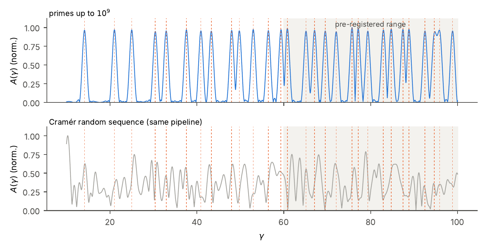
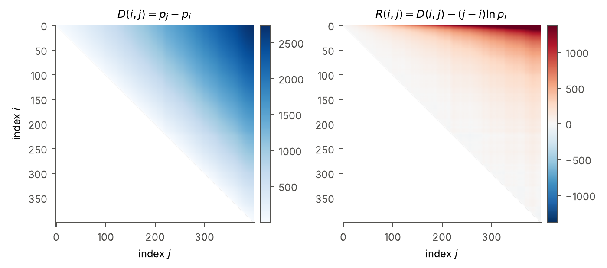
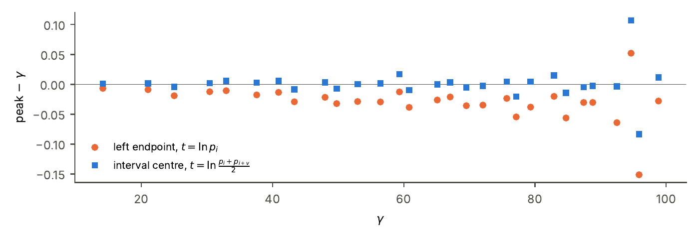
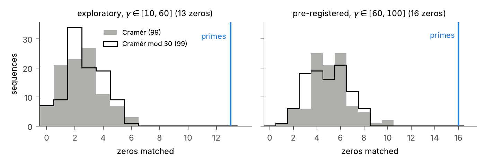

# A Logarithmic Cone of Prime Differences

**An Expository Experiment on the Zeros of the Riemann Zeta Function** · Version 1.1 · October 2026

Rodrigo Pino Osorio · Independent Researcher, Viña del Mar, Chile · 0009-0002-1294-9136ID [0009-0002-1294-9136](https://orcid.org/0009-0002-1294-9136)

[**Read the paper (PDF)**](paper/Pino_Osorio_2026_Logarithmic_Cone_v1.1.pdf) · [Notebooks](notebooks/) · [Cite](#cite)

The matrix of differences *p<sub>j</sub> − p<sub>i</sub>* opens like a cone: the Prime Number Theorem, written geometrically. Remove the cone, read what is left in the variable ln *p*, and its spectrum peaks at the zeros of the Riemann zeta function.

| Result | |
|---|---|
| **29 of 29 zeros** with γ ≤ 100 | matched by spectral peaks, primes up to 10<sup>9</sup> |
| **p = 0.01** | against 99 Cramér and 99 Cramér-mod-30 random sequences |
| **1 of 3 pre-registered criteria failed** | test on 16 new zeros: robustness on half-windows not met |

## Figures

<p align="center">
  
</p>

**Figure 2 · The spectrum of the residual.** Peaks of the residual coincide with all 29 zeros up to γ = 100; a random sequence shows no such pattern. Top: A(γ) for v = 100, primes up to 10<sup>9</sup>, span-centre convention. Dashed lines: zeros of ζ(s); shaded: the pre-registered range. Bottom: one Cramér sequence through the same pipeline (X = 10<sup>8</sup>).

<table>
  <tr>
    <td width="33%" valign="top">
      <a href="figures/fig1_cone.png"></a>
      <br><b>Figure 1 · The cone.</b> D(i, j) = p<sub>j</sub> − p<sub>i</sub> for the first 400 primes, and its residual after subtracting (j − i) ln p<sub>i</sub>.
    </td>
    <td width="33%" valign="top">
      <a href="figures/fig3_bias.png"></a>
      <br><b>Figure 3 · A bias, found and corrected.</b> Labelling each span by its centre removes the downward bias of the peaks.
    </td>
    <td width="33%" valign="top">
      <a href="figures/fig4_nulls.png"></a>
      <br><b>Figure 4 · Against random sequences.</b> No random sequence reaches the count of the primes.
    </td>
  </tr>
</table>

## Scope

**What it shows.** Once the smooth cone is removed, the residual is not featureless: read in ln *p*, it peaks at the zeros of ζ(s). The only input is the sequence of primes: no prime powers, no von Mangoldt function.

**Limitations.** Nothing new about the zeros; precision (≈ 10<sup>−2</sup>) is modest next to established methods. The pre-registered confirmation did not pass: robustness on half-windows failed. A single scale (X = 10<sup>9</sup>), simple random models and conventional thresholds.

## Repository

```
paper/        LaTeX source, vector figures and compiled PDF (xelatex main.tex, twice)
notebooks/    analysis notebooks: v1, v2, v3 and the pre-registered confirmation (clean and executed)
results/      JSON result files of v1, v2 and v3, with a note on what they show about reproducibility
preregistration/  pre-registration of the confirmatory run, its SHA-256 digest and how to check both
figures/      PNG figures for this page
docs/         project page (GitHub Pages)
```

## Reproduce

```bash
pip install -r requirements.txt
jupyter notebook notebooks/
```

The notebooks are deterministic with fixed seeds. A full run takes about 18 minutes on two virtual CPUs and peaks at about 1.3 GB of memory.

## Cite

See [`CITATION.cff`](CITATION.cff), or use GitHub's *Cite this repository* button. The repository is archived on Zenodo with each release; the DOI will be listed here.

## License

Code (notebooks and scripts): [MIT](LICENSE). Text and figures (paper, README files, project page): [CC BY 4.0](LICENSE-CC-BY-4.0.md).

## Use of AI assistance

The author built the initial visualizations that motivated this work, posed the research questions and set the direction of the analysis code, approving every change to the protocol. An AI assistant (Claude, by Anthropic) refined and extended that code under the author's instructions, ran the computations, performed the literature search and drafted the text under the author's direction. The author independently re-ran the main notebooks on Google Colab and is responsible for all interpretations.

Contact: paropc71@hotmail.com
